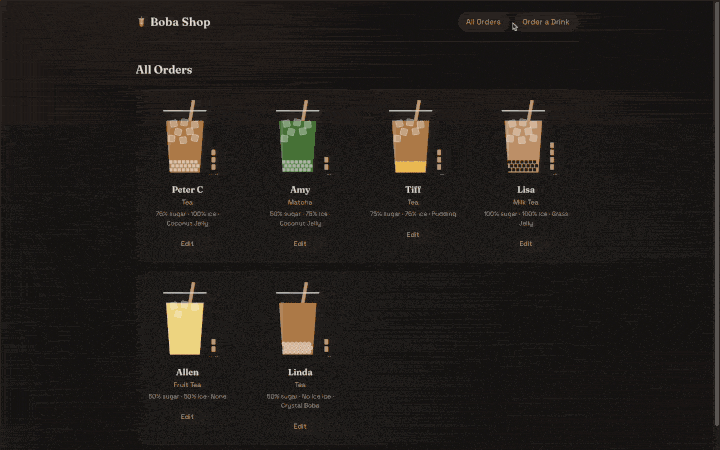

# 🧋 Boba Shop Order App

A full-stack boba tea ordering app. Customize a drink, watch a live cup illustration update with every choice, and manage your orders with full create / read / update / delete support backed by Supabase.



## Features

- **Drink builder:** choose drink type, sugar level, ice level, and topping
- **Live SVG cup:** tea color follows the drink type, ice cubes follow the ice level, the topping sits at the bottom, and a gauge shows the sugar level
- **Full CRUD with Supabase:** create, view, edit, and delete orders stored in a PostgreSQL table
- **Order list:** all orders sorted newest first
- **Detail pages:** each order has its own URL with an estimated price, calorie count, and order time
- **Safe deletes:** confirmation prompt before an order is removed
- **Loading and "not found" states** on the detail and edit pages
- **Responsive dark theme** with a milk tea accent color

## Tech Stack

React 19 · Vite · React Router 7 · Supabase (PostgreSQL) · SVG · CSS

## Project Structure

```
src/
├── client.js            # Supabase client
├── options.js           # drink / sugar / ice / topping choices
├── drinkInfo.js         # price & calorie estimates
├── components/          # DrinkForm, DrinkCup (SVG), DrinkCard, DrinkReceipt, OptionGroup
└── pages/               # CreateDrink, DrinkList, DrinkDetail, EditDrink
```

## Run Locally

```bash
npm install
npm run dev
```
